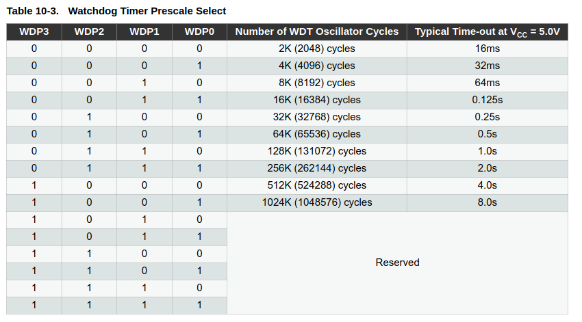

# Watchdog Timer (WDT)

WDT an independent timer that resets the whole chip if your code ever hangs, freezes, or gets stuck in an infinite loop.  
It's also commonly (ab)used as a low-power periodic wake-up source for sleep modes, which we'll touch on since it sets up nicely for the sleep modes topic next.

Two ways to access it

1. Direct register access (`WDTCSR`, `WDTCSR`) - the low-level way, good to understand.
2. `<avr/wdt.h> `- AVR-libc's built-in helper functions that wrap the registers for you. Almost always what you'd actually use in practice.

### 1. Direct register access.

#### Step 1: Execute the Safety Timed Sequence (`WDTCSR`)

To change the timeout configuration or turn off an active Watchdog Timer, you must write a specific bit combination to the Watchdog Timer Control Register (`WDTCSR`) **within 4 clock cycles**.

* **Action A (Trigger the Safety Window)**: 
    Write a `1` to both the Watchdog Change Enable (`WDCE` - **Bit 4**) and the Watchdog System Reset Enable (`WDE` - **Bit 3**) bits simultaneously. Keeping all other bits at `0` during this write is standard practice.

* **Action B (Apply New Settings)**:
    Within the very next **4 clock cycles**, write your desired operational configuration to `WDTCSR` (disabling the timer or selecting a new timeout prescaler).

#### Step 2: Configure the WDT Mode (`WDTCSR`)
During the second write of the timed sequence, you select the operating mode using the `WDIE` and `WDE` configuration bits:

* **Interrupt Mode** (`WDIE = 1`, `WDE = 0`):
    The WDT triggers a standard software interrupt (`WDT_vect`) when the timer expires. This mode is useful for waking the microcontroller safely from deep sleep modes without losing SRAM data to a full reset.

* **System Reset Mode** (`WDIE = 0`, `WDE = 1`):
    The standard safety mode. When the timer expires, the chip executes a complete hardware reset.

* **Interrupt and System Reset Mode** (`WDIE = 1`, `WDE = 1`):
    The timer triggers an interrupt on the first timeout, then automatically clears `WDIE` to `0`. If the code fails to reset the timer before it expires a second time, the chip executes a full system reset.

* **Disabled Mode** (`WDIE = 0`, `WDE = 0`):
    Turns the Watchdog hardware completely off.

#### Step 3: Set the Timeout Prescaler (`WDP3:WDP0`)

The timeout duration is determined by four prescaler bits split across the `WDTCSR` register: `WDP3` (**Bit 5**) and `WDP2:WDP0` (**Bits 2:0**).



#### Step 4: Reset the Timer in Your Software Loop

If System Reset Mode is active, you must continuously reset the internal counter from your main application loop before the chosen timeout window expires.

* **Action**: Execute the dedicated assembly command `asm("WDR")`. This clears the internal timer counter back to zero, proving to the hardware that your software loop is still executing normally.

```c
// For 2 seconds specifically (WDP3:0 = 0111):
void wdt_enable_2s(void) {
    WDTCSR |= (1 << WDCE) | (1 << WDE);   // allow changes (must set both together)
    
    // within 4 clock cycles, set the actual config:
    WDTCSR = (1 << WDE)                   // enable watchdog reset
            | (1 << WDP1) | (1 << WDP0) | (1 << WDP2);   // 2s, WDE set = reset mode
}

/***********************************************************/

void reset_wdt(void) {
    __asm__ __volatile__("wdr");   // WDR instruction - resets the watchdog's internal counter
}

```
>> **Why the two-step timed sequence exists:** just like the EEPROM write handshake, this prevents a runaway/glitching program from accidentally disabling or reconfiguring the watchdog -> since doing so would defeat its entire safety purpose. `WDCE` (Watchdog Change Enable) has to be set together with `WDE` first, and then the real configuration write must happen within **4 clock cycles**.


**Interrupt mode (instead of, or in addition to, reset)**

The watchdog can also fire an interrupt instead of (or before) resetting - useful for things like "warn me the system's about to reset" or, as we'll see in the sleep modes topic, periodic wake-ups from sleep without needing a full reset.

```c
#include <avr/io.h>
#include <avr/interrupt.h>
#include <avr/wdt.h>

volatile uint8_t wdt_fired = 0;

ISR(WDT_vect) {
    wdt_fired = 1;
    // Note: in interrupt-only mode (WDE=0, WDIE=1), the watchdog does NOT reset the chip -
    // it just fires this ISR once, then WDIE is auto-cleared by hardware (falls back to reset mode
    // if WDE is still set, or disables itself if not) - see next "interrupt + reset" mode
}

void wdt_interrupt_init(void) {
    WDTCSR |= (1 << WDCE) | (1 << WDE);
    WDTCSR = (1 << WDIE) | (1 << WDP1) | (1 << WDP0) | (1 << WDP2);   // 2s, interrupt mode (WDE=0 : No Reset)
    sei();
}

int main(void) {
    wdt_interrupt_init();

    while (1) {
        if (wdt_fired) {
            wdt_fired = 0;
            // handle periodic wake/warning here
        }
    }
}
```

**`Interrupt + reset` mode (warn, then reset if not acknowledged)**

Setting both `WDIE` and `WDE` gives you one interrupt first; if the watchdog isn't fed before the next timeout, it resets the chip on the second occurrence:
```c
{
    WDTCSR |= (1 << WDCE) | (1 << WDE);
    WDTCSR = (1 << WDIE) | (1 << WDE) | (1 << WDP1) | (1 << WDP0) | (1 << WDP2);
}
```

-----------------------------


### 2. using `<avr/wdt.h> `- AVR-libc's built-in helper functions 


```c
#include <avr/io.h>
#include <avr/wdt.h>
#include <util/delay.h>
#include <stdio.h>
#include "avr_uart.h"

int main(void) {
    uart_init();
    stdout = &uart_output;

    printf("Watchdog test starting...\n");
    wdt_enable(WDTO_2S);   // reset if not fed within 2 seconds

    uint8_t count = 0;

    while (1) {
        printf("Loop count: %u\n", count);
        count++;

        if (count < 5) {
            wdt_reset();
            _delay_ms(1000);
        } else {
            printf("Simulating a hang now - watchdog should reset the board...\n");
            while (1) {
                // intentionally do nothing - no wdt_reset() called here
            }
        }
    }
}
```
