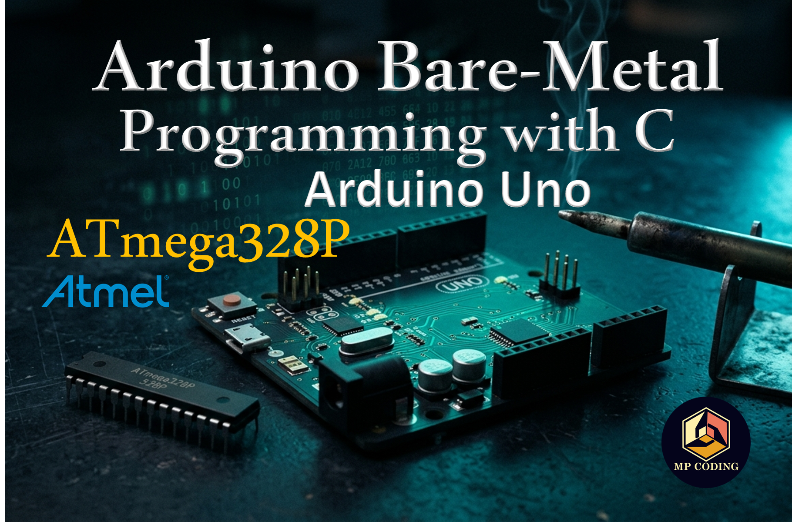

# Arduino Bare-Metal Programming with C - `No IDE`

A beginner-to-master series on programming the Arduino Uno (`ATmega328P`) directly at the register level.    
    **no Arduino IDE**, **no Arduino core library**,     
    `just C`, `avr-gcc`, and a `datasheet`.

------------------

## Why bare-metal?

The Arduino IDE and `Arduino.h` hide almost everything interesting about the chip you're programming. This series strips that away. Every tutorial talks straight to the ATmega328P's registers - `DDRx`, `PORTx`, `TCCRx`, `UCSRx`, `TWCR`, and friends - using nothing but:

* C, compiled with avr-gcc
* avr-libc for register/interrupt-vector definitions
* Make to build
* avrdude to flash, over the Uno's stock bootloader

No sketches. No `.ino` files. No hidden `setup()/loop()` magic ,     
 just `main()` and the `datasheet`.

-------------------------

## Series roadmap

| #  | Topic | Key concepts |
|---|-------|--------------|
| 00 | [Setup & Installation](./00_setup/) | Toolchain (`avr-gcc`, `avr-libc`, `avrdude`, `make`), **Linux/macOS/Windows** install, **VS Code config**. |
01 | [LED Blink](./01_led_blink/) | `DDRx`, `PORTx`.
02 |  [Button Input](./02_button_input/) | Polling input, pull-ups, then `PCINT/INT0` external interrupts
03 | Timers & PWM | `Timer0/1/2`, prescalers, fast PWM for LED dimming and servo control
04 | ADC Read | Single-channel ADC, then multi-channel switching
05 | UART | Polling TX/RX, then interrupt-driven serial I/O
06 | SPI (Master & Slave) | Full-duplex SPI
07 | TWI/I2C (Master & Slave) | I2C protocol from scratch, real sensor read (**BMP180**)
08 | EEPROM Read/Write | Persistent settings storage, wear considerations
09 | Watchdog Timer | Fault recovery, WDT-triggered reset vs interrupt mode
10 | Sleep Modes | Power-down mode, wake-on-interrupt, power measurement
11 | Custom Serial Protocol | Framing, checksums, building a protocol over UART

